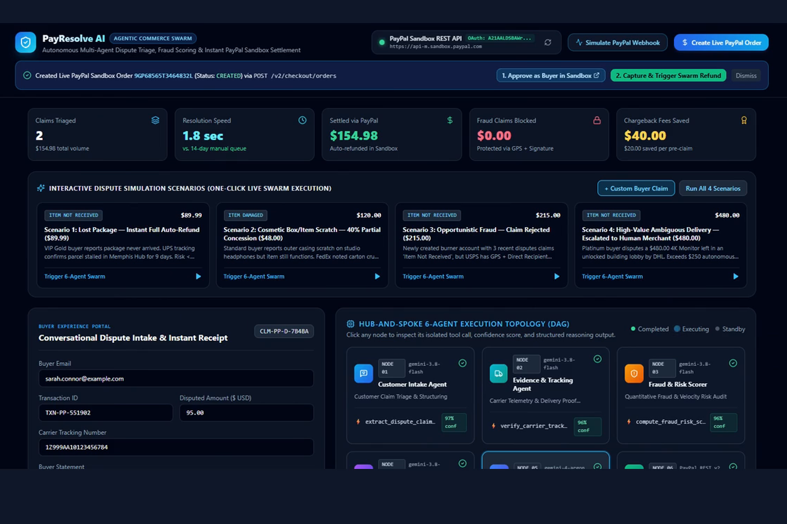
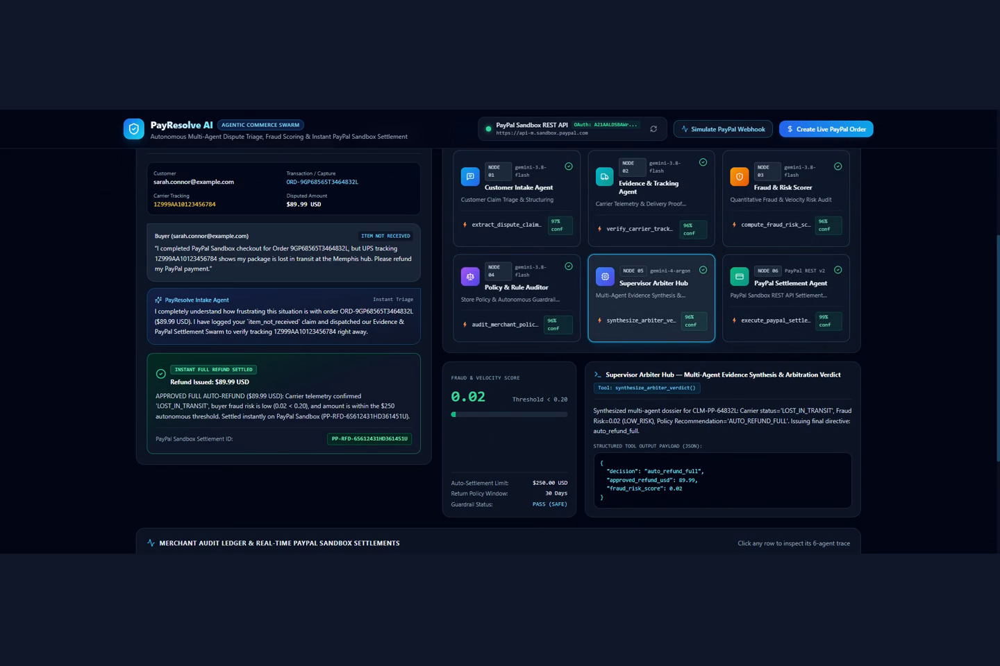
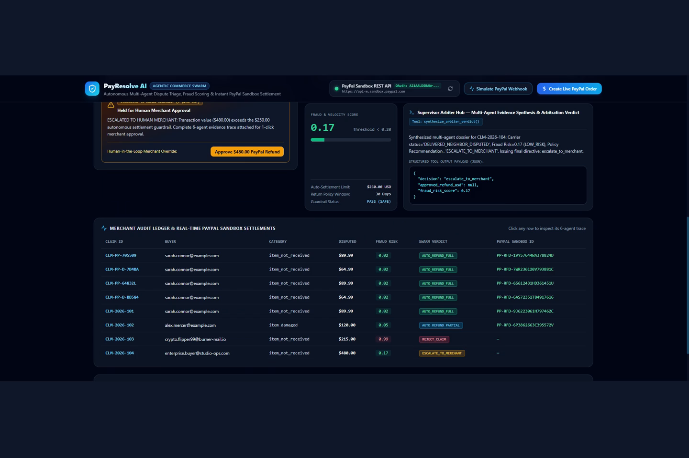

# PayResolve AI

PayResolve AI is a multi-agent dispute resolution app built for the PayPal AI Hackathon. It checks shipping carrier scans, buyer refund history, and store return rules before issuing or blocking refunds through the PayPal Sandbox REST API.

- **Video Demo (2m 51s):** [Watch on YouTube](https://youtu.be/dJLid7slWCc)
- **Repository:** [https://github.com/Mulham2299/PayResolve-AI](https://github.com/Mulham2299/PayResolve-AI)



## Why I built this

When a customer opens a "package never arrived" or "item arrived damaged" dispute on an online order, someone on the merchant team has to look up the PayPal capture ID, check the shipping carrier's tracking page, read the store's return rules, and decide whether to refund the money. Waiting too long turns the complaint into a formal chargeback with a $15 to $20 dispute fee, while refunding every complaint automatically loses money on false claims.

PayResolve AI runs those checks automatically before any money moves in PayPal.

## How the 6-agent pipeline works

Each dispute passes through six focused agents:

1. **Customer Intake Agent:** Reads the buyer's claim and extracts the PayPal capture ID, order ID, carrier tracking number, claim category, and disputed amount.
2. **Evidence & Tracking Agent:** Checks the carrier tracking record for that tracking number (lost in transit, still moving, or delivered with GPS and signature) and reviews damage notes.
3. **Fraud & Risk Scorer:** Calculates a risk score between `0.00` and `1.00` from the buyer's account age, recent dispute count, and whether their claim contradicts the carrier scan.
4. **Policy & Rule Auditor:** Checks the store's 30-day return window, the 40% partial concession rule for cosmetic damage, and the $250 automatic refund limit.
5. **Supervisor Arbiter Hub:** Reads the three reports and picks one of four outcomes: `AUTO_REFUND_FULL`, `AUTO_REFUND_PARTIAL`, `REJECT_CLAIM`, or `ESCALATE_TO_MERCHANT`.
6. **PayPal Settlement Agent:** Authenticates with PayPal OAuth 2.0 (`POST /v1/oauth2/token`) and calls the PayPal Captures Refund API (`POST /v2/payments/captures/{capture_id}/refund`) for approved full or partial refunds, or blocks the payout when a claim is rejected or escalated.



## Preset test scenarios (happy and unhappy paths)

- **Scenario 1 (Happy Path — Full Auto-Refund, $89.99):** UPS tracking shows the package stalled in Memphis for 9 days (`LOST_IN_TRANSIT`), fraud risk is `0.02`, and the PayPal Settlement Agent issues a full `$89.99` refund.
- **Scenario 2 (Happy Path — 40% Partial Concession, $120.00 -> $48.00):** Buyer reports a cosmetic scratch on studio headphones and offers to keep them for a discount. The Policy Auditor applies the 40% partial concession rule and settles `$48.00` via PayPal.
- **Scenario 3 (Unhappy Path — Fraud Rejected, $215.00):** A newly created burner account with 3 recent disputes claims an order never arrived, but USPS recorded GPS delivery and a direct signature. Fraud risk is `0.99`, and the claim is rejected (`$0.00` disbursed).
- **Scenario 4 (Unhappy Path — High-Value Escalation, $480.00):** A $480 4K monitor exceeds the store's $250 automatic settlement cap, so the payout is paused and escalated to a human manager with a one-click override button.



## Tech stack

- **Backend:** Python, FastAPI, Pydantic v2, `httpx`
- **PayPal Sandbox Integration (`backend/paypal/client.py`):** OAuth 2.0 (`POST /v1/oauth2/token`), Orders v2 (`POST /v2/checkout/orders` and `/capture`), Captures & Refunds (`GET` / `POST /v2/payments/captures/{id}/refund`), Customer Disputes (`GET /v1/customer/disputes`), and Webhook event handling (`POST /api/paypal/webhooks`)
- **AI Models (`backend/agents/swarm.py`):** Google Gemini (`google-genai` SDK) with deterministic tool fallbacks
- **Frontend (`frontend/src/App.jsx`):** React 18, Vite, Tailwind CSS, Lucide icons
- **Testing & Deployment:** `pytest` test suite (`tests/test_swarm_and_api.py`), Postman collection (`docs/PayResolve_AI.postman_collection.json`), and Render blueprint (`render.yaml`)

## Running the project locally

### 1. Clone the repository
```powershell
git clone https://github.com/Mulham2299/PayResolve-AI.git
cd PayResolve-AI
```

### 2. Configure environment variables
Copy `.env.example` to `.env` and add your PayPal Sandbox `PAYPAL_CLIENT_ID` and `PAYPAL_CLIENT_SECRET`:
```powershell
copy .env.example .env
```

### 3. Quick start (Windows one-click)
```powershell
.\start_demo.bat
```
Or start the backend and frontend in two terminals:

```powershell
# Terminal 1 — FastAPI Backend (Port 8000)
.\venv\Scripts\uvicorn.exe backend.api.main:app --reload --host 127.0.0.1 --port 8000

# Terminal 2 — React + Vite Frontend (Port 5173)
cd frontend
npm.cmd install
npm.cmd run dev
```

Open `http://localhost:5173` in your browser.

### 4. Run the automated tests
```powershell
.\venv\Scripts\pytest.exe tests/ -v
```

## License
This project is licensed under the [MIT License](LICENSE).
